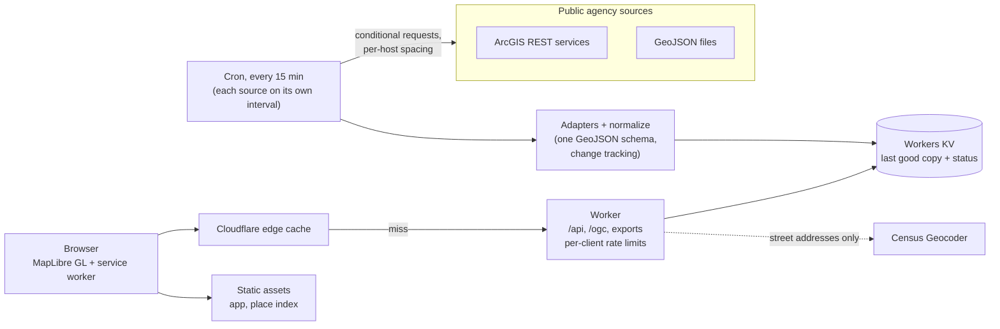

# Predator Watch

*A [BitPrairie](https://bitprairie.com/predator-watch/) project.*

**Public agency wolf data on one map, with the source, date and freshness on every item.**

**Live: [app.predatorwatch.org](https://app.predatorwatch.org)** · [How it works](https://app.predatorwatch.org/about) · [Source status](https://app.predatorwatch.org/status) · [API](docs/api.md) · Apache-2.0


## Why it exists

Wildlife and land agencies publish predator data, but each one does it
differently: ArcGIS services, raw GeoJSON, PDFs, JPEG maps, each on its own
site with its own update schedule. To see what is public for an area you have
to know every agency, find every service and work out how old each layer is.

Predator Watch pulls the **public, machine-readable agency sources** into one
map and one format. It is strict about two things:

- **Provenance.** Every item says which agency published it, under what
  terms, and links back to the original.
- **Freshness.** Every layer shows when the agency last updated it and when
  this map last checked. If a refresh fails, the map says so and keeps the
  last good copy. The [status page](https://app.predatorwatch.org/status)
  lists every source's last success and last error.

Data is never shown more precisely than the agency publishes it.

## Privacy

The public map contains **only public agency data**. There is no rancher data,
no user-submitted sightings and no visitor location tracking. Place search for
towns, counties and ZIP codes runs in your browser; only street addresses are
sent to the U.S. Census Bureau Geocoder. A private collaboration space is
**Planned** and would be a separate product with its own agreements.

## Features

- Wolf activity, wolf management areas and context layers (wildfire
  perimeters, weather alerts, land ownership, grazing allotments, protected
  areas, counties, tribal lands, terrain, water, land cover).
- Freshness badges, a details panel for every item and a "Recent changes" feed.
- Place search, shareable links that keep the view and layers, a dark map,
  and an offline copy of the last data you loaded.
- GeoJSON, KML and CSV downloads, a JSON API and an
  [OGC API Features](https://app.predatorwatch.org/ogc) service for GIS tools.
- Built for traffic spikes: every public request is served from the edge cache
  or Workers KV, and only a scheduled job ever talks to agency servers.

## Data sources

Live means the map reads it today. Full details, endpoints and terms:
[docs/data-sources.md](docs/data-sources.md).

| Layer | Agency | Format | Refresh | Status |
| --- | --- | --- | --- | --- |
| Collared gray wolf locations (generalized cells) | California Department of Fish and Wildlife | GeoJSON | 60 min | Live |
| Wolf pack areas (current year) | Washington Department of Fish and Wildlife | ArcGIS | Daily | Live |
| Gray wolf distribution | Montana Fish, Wildlife & Parks | ArcGIS | Daily | Live |
| Mexican wolf occupied range (2020) | U.S. Fish and Wildlife Service | ArcGIS | Daily | Live |
| Mexican Wolf Experimental Population Area | U.S. Fish and Wildlife Service | ArcGIS | Weekly | Live |
| Wolf management zones | Idaho Department of Fish and Game | ArcGIS | Weekly | Live |
| Wolf regions and management units | Montana Fish, Wildlife & Parks | ArcGIS | Weekly | Live |
| Wolf hunt areas | Wyoming Game and Fish Department | ArcGIS | Weekly | Live |
| Wolf management zones | Wisconsin Department of Natural Resources | ArcGIS | Weekly | Live |
| Wildfire perimeters (current) | National Interagency Fire Center | ArcGIS | 15 min | Live |
| Weather watches, warnings and advisories | National Weather Service | ArcGIS | 15 min | Live |
| Land ownership, grazing allotments, PAD-US, counties, tribal lands, terrain, water, land cover | BLM, USDA Forest Service, USGS, U.S. Census Bureau, MRLC | Agency map services, drawn live | n/a | Live |
| Agency wolf activity maps published only as PDF or images, token-only services, and agencies with no public layer yet | Several state and federal agencies | – | – | Planned |

Know a public agency dataset that belongs here?
[Suggest a source](https://github.com/steelhead99x/predator-watch-app/issues/new?template=new-source.yml).

## How it works



- `src/adapters/`: a generic ArcGIS REST adapter (pagination, `outSR=4326`,
  change detection through `editingInfo.lastEditDate`, timeouts, retries,
  per-host spacing) and a GeoJSON adapter (ETag / Last-Modified).
- `src/config/sources.ts`: every source, validated by `src/registry.ts`.
- `src/cache.ts`: refreshes due sources, keeps the last good copy when an
  agency is down, records failures, and tracks what changed.
- `src/index.ts`: the Worker. Public routes read KV only and go through the
  Cache API; the cron is the only code that calls agencies.

## Add a source in about 20 lines

A public ArcGIS layer is a config entry in `src/config/sources.ts`, with no
code:

```ts
{
  type: "arcgis",
  id: "agency-wolf-units",
  name: "Wolf management units",
  category: "wolf-management",          // wolf-activity | wolf-management | context
  species: "Gray wolf",
  agency: "Example Department of Fish and Wildlife",
  url: "https://services.arcgis.com/.../FeatureServer/0",
  infoUrl: "https://www.arcgis.com/home/item.html?id=...",
  license: "Public data provided as is; credit the agency.",
  attribution: "Example Department of Fish and Wildlife",
  cadence: "Changes with hunting regulations.",
  refreshMinutes: 7 * 24 * 60,
  precision: "management-unit",
  maxAllowableOffset: 0.002,             // simplify large polygons at the source
  fields: {
    label: "Unit {UNIT_NAME}",
    observedAt: { fromLayer: true },     // use the layer's last edit date
  },
  style: { color: "#6b5b95", dashed: true },
}
```

Run `npm test` (the registry test validates every entry) and add a row to
`docs/data-sources.md`.
The full walkthrough is in
[docs/adding-an-arcgis-layer.md](docs/adding-an-arcgis-layer.md), and
[CONTRIBUTING.md](CONTRIBUTING.md) has the checklist.

## Development

Requires Node.js 20 or newer.

```sh
npm i                  # installs dependencies and copies MapLibre into public/vendor
npm test               # vitest suite (recorded fixtures, no network)
npm run typecheck      # TypeScript
npx wrangler dev       # http://127.0.0.1:8787
curl "http://127.0.0.1:8787/cdn-cgi/local/scheduled"   # run the refresh job once
npm run loadtest       # autocannon against wrangler dev; see docs/loadtest.md
```

Until the refresh job has run, sources show "Loading…" (the CDFW layer shows
its bundled sample, badged "Sample data").

### Configuration and secrets

- No keys are needed. All current sources are public.
- An ArcGIS API key is optional and only used by sources that set
  `useApiKey: true` (none do today). Supply it as a secret only: `.dev.vars`
  locally (gitignored) or `npx wrangler secret put ARCGIS_API_KEY`.
- The Worker uses a KV namespace (`LAYER_CACHE`) and four Rate Limiting
  bindings. If you deploy your own copy, create your own KV namespace and
  pick `namespace_id` values for the rate limits that are unique in your
  account.

### Cost and limits

The cron runs every 15 minutes, but each source is only checked when its
own interval is due. Expect roughly 550 KV writes a day with the current
sources, inside the Workers free plan limit of 1,000. Visitor traffic only
reads KV, and most of it is answered by the edge cache. Load test results:
[docs/loadtest.md](docs/loadtest.md).

## Contributing

Bug reports, new public sources and fixes are welcome. See
[CONTRIBUTING.md](CONTRIBUTING.md), the [Code of Conduct](CODE_OF_CONDUCT.md)
and [SECURITY.md](SECURITY.md).

## Data and terms

Map data © the agencies named on each layer, used under their published terms.
Basemap: [OpenFreeMap](https://openfreemap.org/) © [OpenMapTiles](https://www.openmaptiles.org/),
data from [OpenStreetMap](https://www.openstreetmap.org/copyright) contributors.
Place search: U.S. Census Bureau Gazetteer and Geocoder. This product uses the
Census Bureau Data API but is not endorsed or certified by the Census Bureau.
This map is for public information only. It is not a substitute for the
agencies' own products, and a shaded area is not a current animal position.

## Brand

The logo, colors and type follow the [BitPrairie](https://bitprairie.com/predator-watch/) brand.
`public/brand.css` holds the shared tokens, the masthead and the credits block for the map,
`/about` and `/status`. `public/theme.js` is BitPrairie's theme script (same `bp-theme` key),
changed only to follow the device setting when no choice is saved. Fonts are self-hosted
IBM Plex Sans and IBM Plex Mono under the SIL Open Font License 1.1 (`public/fonts/OFL-*.txt`).
Layer colors come from the same palette, with a light and a dark value for each layer that
keep at least 3:1 contrast against the basemap (checked in `test/brand.test.ts`).
The BitPrairie symbol and wordmark are BitPrairie marks; the Apache-2.0 license covers the code, not the marks.

Part of BitPrairie Predator Watch. Code licensed under Apache-2.0.
