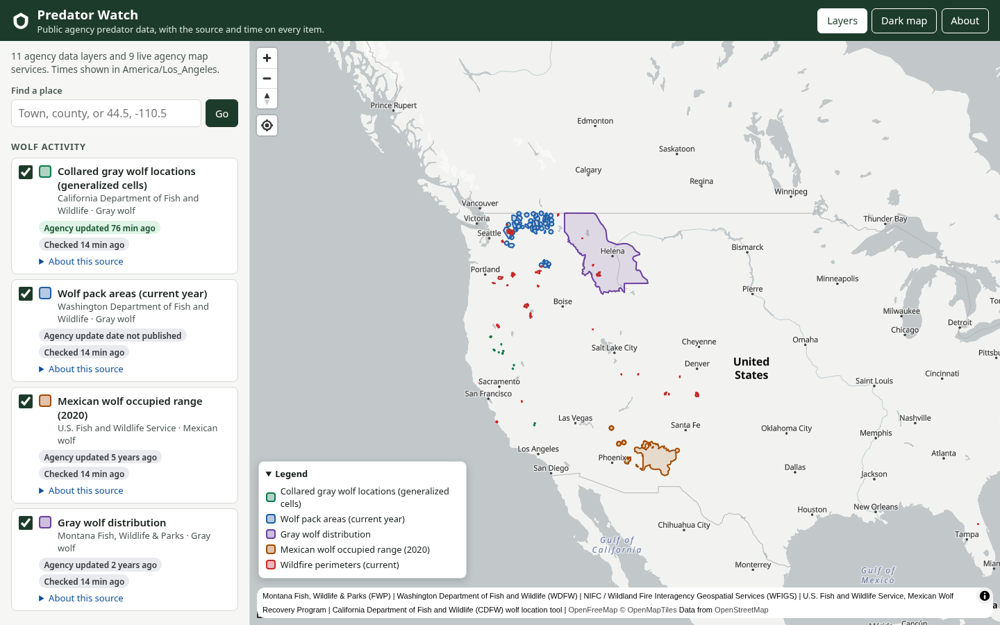

# Predator Watch

A free, open-source public web map that brings together public government and
agency predator data in one place, starting with gray wolves. Every item on the
map shows its source, when the agency observed it, and when this map received
it. Data is never shown more precisely than the agency publishes it.



Part of BitPrairie Predator Watch. Licensed under Apache-2.0.

## What it does today

- A mobile-friendly map (MapLibre GL on free OpenFreeMap tiles) with
  layers for wolf activity, wolf management areas and context.
- Public agency sources only, refreshed on a schedule into a cache, as close to
  real time as each source allows. See [docs/data-sources.md](docs/data-sources.md)
  for every source, its owner, cadence, terms, and whether it is Live or Planned.
- A freshness badge on every layer (agency update date, last check, sample
  data, or a failed check) and a details panel on every item with species,
  source, agency, observed time, received time, precision and terms.
- Context layers: current wildfire perimeters, weather watches, warnings and
  advisories, public land ownership, and federal grazing allotments.
- A pluggable adapter framework. Adding a public ArcGIS REST layer is a config
  change only; see [docs/adding-an-arcgis-layer.md](docs/adding-an-arcgis-layer.md).

## Rancher plan (private, paid)

The rancher plan adds a private assistant built on intelligence and realtime
systems. It is off unless the private storage binding is set, and the public
map works the same without it.

- **Ask by text or voice.** Open **Rancher** on the map, sign in with your
  access key, and type or talk. Answers are a few sentences.
- **Sources on every answer.** Each answer lists its sources, with when each
  fact was observed and when we received it. If the data doesn't cover the
  question, the assistant says it doesn't know.
- **Automated lookups, one job each:**
  - wolf activity near your ranch, from agency layers, your own records, and
    shared rancher reports;
  - wolf activity in or near your grazing allotments for a date range;
  - fire perimeters and weather watches, warnings, and advisories near you;
  - who to call and how to report, from contacts on your account;
  - how fresh each data source is;
  - excerpts from reference documents on nonlethal deterrents;
  - a weekly summary of activity, alerts, and freshness for a ranch;
  - your account's own audit log.
- **Location tiers.** Your records stay exact and private to you. Shared
  reports are snapped to 1 to 2 mile cells and delayed 48 to 72 hours. Den
  sites are never shared.
- **Bring your own assistant.** Connect it over MCP with OAuth or your access
  key. See [docs/mcp.md](docs/mcp.md).
- **Every lookup is logged** to your account's audit log, with per-account
  rate limits.
- **Stays in its lane.** It answers about your data and general ranching
  questions, and labels general information as such. It provides data and
  general information, not legal, veterinary, or financial advice, and points
  you to the right agency or professional instead. See
  [docs/assistant-guardrails.md](docs/assistant-guardrails.md).
- **Try it offline.** `npm run dev:mock` runs a local demo account with a test
  model, no key needed.

How it works, the safety rules, the API, and configuration are in
[docs/rancher-assistant.md](docs/rancher-assistant.md).

## Planned

- **Private collaboration space (Planned, paid):** a private space for
  ranchers, community members, and local, state, and federal agencies to share
  data under data-sharing agreements, with points of contact and schedules.
  The rancher plan above is the first part; account sign-in, billing, record
  upload, and a verified agency contact directory are Planned.
- **More agency sources (Planned):** candidates still being verified are listed
  in [docs/data-sources.md](docs/data-sources.md).

## How it works

```
Cron (every 15 min) ──> adapters ──> normalized GeoJSON in Workers KV
                                              │
Browser ── /api/layers, /api/sources/:id ─────┘     static assets (public/)
```

- `src/adapters/` holds the adapters: a generic ArcGIS REST adapter
  (pagination, `outSR=4326`, layer metadata, change detection through
  `editingInfo.lastEditDate`, polite rate limiting, timeouts and retries) and
  a GeoJSON adapter (conditional requests with ETag or Last-Modified).
- `src/schema.ts` defines the common feature schema: `species`, `source_id`,
  `agency`, `observed_at` (with its precision), `received_at`, `precision`,
  `geometry_type`, `attribution`, `url`, `license` and `details`.
- `src/config/sources.ts` lists every source. `src/registry.ts` validates it.
- `src/cache.ts` refreshes each source when it is due, keeps the last good copy
  if an agency is down, and falls back to a clearly marked bundled sample only
  when nothing has ever been fetched.
- `src/index.ts` is the Worker: `GET /api/layers`, `GET /api/sources/:id`,
  `GET /api/health`, and the scheduled refresh.

## Development

Requires Node.js 20 or newer.

```sh
npm i                # installs dependencies and copies MapLibre into public/vendor
npm test             # vitest suite (uses recorded fixtures, no network)
npm run typecheck    # TypeScript
npx wrangler dev     # http://127.0.0.1:8787
```

`wrangler dev` simulates KV locally. The first request to `/api/layers` warms
the cache in the background; to run the scheduled refresh by hand:

```sh
curl "http://127.0.0.1:8787/cdn-cgi/local/scheduled"
```

If the CDFW feed cannot be reached on first load, that layer serves the bundled
sample in `src/fixtures/` and is badged "Sample data".

### Configuration and secrets

- No keys are needed for the public map. All current sources are public.
- The rancher assistant's text and voice need `XAI_API_KEY`, as an
  environment secret only (`.dev.vars` locally, `npx wrangler secret put
  XAI_API_KEY` in production). Private features also need the `PRIVATE_KV`
  binding (and `OAUTH_KV` for MCP OAuth); see
  [docs/rancher-assistant.md](docs/rancher-assistant.md#configuration).
- An ArcGIS API key is optional and only used by sources that set
  `useApiKey: true` (none do today). Supply it as an environment secret only:
  put `ARCGIS_API_KEY=...` in `.dev.vars` for local work (gitignored; see
  `.dev.vars.example`) or use `npx wrangler secret put ARCGIS_API_KEY`.
  Never commit it.
- Before a first deployment, create a KV namespace with
  `npx wrangler kv namespace create LAYER_CACHE` and put its id in
  `wrangler.jsonc` (the id in the repo is a placeholder).

### Cost and limits

The cron runs every 15 minutes, but each source is only checked when its own
refresh interval is due, and unchanged sources only update a small status
record. Expect roughly 450 KV writes a day with the current sources, inside the
Workers free plan limit of 1,000 a day. Agency servers are called at most once
per refresh with a per-host minimum interval.

## Data and terms

Map data © the agencies named on each layer, used under their published terms.
Basemap: [OpenFreeMap](https://openfreemap.org/) © [OpenMapTiles](https://www.openmaptiles.org/),
data from [OpenStreetMap](https://www.openstreetmap.org/copyright) contributors.
This map is for public information only. It is not a substitute for the
agencies' own products and is not a current animal position.
