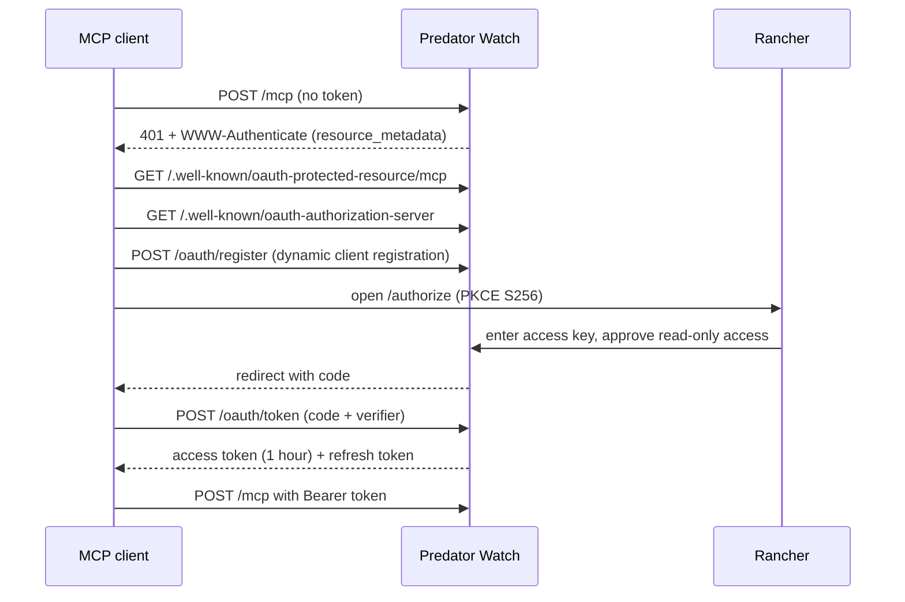

# Connect your own assistant (MCP)

Ranchers on the private plan can connect their own assistant to Predator Watch
over the Model Context Protocol (MCP). It gets the same read-only tools as the
built-in rancher assistant, with the same tenant checks, location tiers, rate
limits, and audit log. See [rancher-assistant.md](rancher-assistant.md) for
what each tool does.

- **Endpoint:** `https://app.predatorwatch.org/mcp` (Streamable HTTP, stateless).
- **Server name:** `predator-watch-rancher`, version `0.1.0`.
- **Tools:** `recent_predator_activity`, `allotment_wolf_activity`,
  `fire_weather_alerts`, `agency_contacts_and_reporting`, `data_freshness`,
  `nonlethal_deterrents`, `weekly_summary`, `my_audit_log`. All are marked
  read-only (`readOnlyHint: true`) and return `structuredContent` that matches
  each tool's output schema, including a `sources` list with observed and
  received times.
- **Needs:** an active rancher plan. Without one, `/mcp` returns `402`.

## Option 1: OAuth (most MCP clients)

Clients that support MCP authorization can connect with just the URL.



1. Add a remote MCP server in your client with the URL above.
2. Your browser opens the Predator Watch sign-in page. It shows the app's name,
   where it will send you back to, and that access is read-only.
3. Enter your rancher access key and choose **Allow**, or **Deny**.
4. The client gets a token for scope `rancher:read`. A token never grants more
   than the access key that approved it.

Each request rebuilds your account from storage, so a plan change takes effect
right away rather than when the token expires. Revoking an access key stops
direct bearer use of that key; a screen to list and revoke connected apps is
Planned.

| Endpoint | Purpose |
| --- | --- |
| `/.well-known/oauth-protected-resource/mcp` | Protected resource metadata (RFC 9728). |
| `/.well-known/oauth-authorization-server` | Authorization server metadata (RFC 8414). |
| `/oauth/register` | Dynamic client registration (RFC 7591). |
| `/authorize` | Sign-in and consent page. |
| `/oauth/token` | Token endpoint (authorization code with PKCE, refresh). |

## Option 2: access key as a bearer token

Clients that let you set a header can skip OAuth:

```
Authorization: Bearer pwk_…
```

For example, a JSON config many clients accept:

```json
{
  "mcpServers": {
    "predator-watch": {
      "url": "https://app.predatorwatch.org/mcp",
      "headers": { "Authorization": "Bearer pwk_your_key" }
    }
  }
}
```

Quick check with curl:

```sh
curl -s https://app.predatorwatch.org/mcp \
  -H "Authorization: Bearer $PW_KEY" \
  -H "Content-Type: application/json" \
  -H "Accept: application/json, text/event-stream" \
  -d '{"jsonrpc":"2.0","id":1,"method":"tools/list","params":{}}'
```

Keep the key private. Anyone with it can read your account's data.

## Scopes

| Scope | Tools |
| --- | --- |
| `rancher:read` | All tools below. |
| `activity:read` | `recent_predator_activity`, `allotment_wolf_activity` |
| `alerts:read` | `fire_weather_alerts` |
| `directory:read` | `agency_contacts_and_reporting` |
| `docs:read` | `data_freshness`, `nonlethal_deterrents` |
| `summary:read` | `weekly_summary` |
| `audit:read` | `my_audit_log` |

`tools/list` shows only the tools your credential's scopes allow. Write scopes
are Planned.

## Using the results well

Tell your assistant to:

- cite the `sources` in each result, with their observed and received times;
- say it doesn't know when a result sets `unknown`, instead of guessing;
- say a feature is Planned when a result sets `planned`.

The server's MCP `instructions` say the same.

## Running it yourself

`/mcp` needs the `PRIVATE_KV` binding. OAuth also needs `OAUTH_KV`. Without
`OAUTH_KV`, `/mcp` accepts access keys only. See `wrangler.jsonc` for the
commented bindings.

## References

- Cloudflare MCP handler API: https://developers.cloudflare.com/agents/model-context-protocol/apis/handler-api/
- Securing an MCP server: https://developers.cloudflare.com/agents/model-context-protocol/guides/securing-mcp-server/
- MCP authorization spec: https://modelcontextprotocol.io/specification/2025-06-18/basic/authorization
