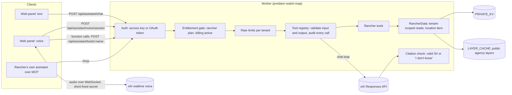

# Rancher assistant (private rancher plan)

The rancher assistant answers a paying rancher's questions by text or voice. It
looks up facts with a fixed set of read-only tools, then answers in a few
sentences. Every answer lists its sources, with when each fact was observed and
when we received it. If the tools don't cover the question, it says "I don't
know" instead of guessing.

The same tools are exposed to outside assistants over MCP, so a rancher can
connect their own assistant. See [mcp.md](mcp.md).

Everything here is off unless the private storage binding (`PRIVATE_KV`) is set.
Without it, `/api/assistant/*` and `/mcp` return `503 not_configured`, and the
public map works as before.

## Architecture

- **Text.** `POST /api/assistant/chat` runs a tool loop with the xAI Responses
  API (`store: false`, up to 5 rounds). The model only sees tool output, never
  the raw store. The final text goes through the citation check before it is
  sent, and the client gets Server-Sent Events.
- **Voice.** The Worker mints a 60-second xAI client secret. The browser opens
  the realtime WebSocket straight to xAI with it, so audio never passes through
  the Worker. When the voice model calls a tool, the browser runs it through
  `POST /api/assistant/tools/:name` with the rancher's own credential, so the
  same registry, tenant checks, location tiers, rate limits, and audit log
  apply. Sources for spoken answers are shown on screen.
- **MCP.** `/mcp` serves the same registry to outside assistants with OAuth
  2.1 or an access key.

## What the agents do

Each tool has one job. All are read-only and need the rancher plan.

| Tool | Job | Scope |
| --- | --- | --- |
| `recent_predator_activity` | Wolf activity near one of your ranches: public agency layers, your own records (exact), and shared rancher reports (generalized cells, delayed). | `activity:read` |
| `allotment_wolf_activity` | Wolf activity inside or near one of your grazing allotments for a date range. | `activity:read` |
| `fire_weather_alerts` | Current fire perimeters and weather watches, warnings, and advisories near a ranch. | `alerts:read` |
| `agency_contacts_and_reporting` | Who to call and how to report, from contacts on your account. Each entry shows who published it and when it was verified. | `directory:read` |
| `data_freshness` | When each source was last updated by the agency and last checked by us, and whether a check failed. | `docs:read` |
| `nonlethal_deterrents` | Excerpts from reference documents on your account or our library, quoted with their source. No advice beyond the documents. | `docs:read` |
| `weekly_summary` | A seven-day roll-up of activity, alerts, and freshness for one ranch. | `summary:read` |
| `my_audit_log` | Your account's recent assistant and MCP tool calls. | `audit:read` |

`rancher:read` grants all of the scopes above. When a tool has no data for a
question it returns `unknown`, and features that aren't built yet come back as
`planned`, so the assistant can say so.

## Answer rules

These are enforced in code, not only in the prompt (`src/guardrails/`,
`src/agents/citations.ts`, `src/rancher/prompt.ts`):

1. **Sources on every answer.** Each tool result carries sources labeled
   `S1`, `S2`, … with title, publisher, URL, observed time, and received time.
   The model must cite them as `[S1]`. Markers that don't match a source from
   this turn are removed.
2. **"I don't know" beats guessing.** Sentences that state facts about the
   data without a valid citation are dropped. If nothing sourced is left, the
   answer becomes "I don't know…". An answer with no data claims is general
   ranching information and is labelled "General information, not from your
   Predator Watch data".
3. **Neutral.** The assistant reports what the sources say. It does not take
   sides on contested topics (for example, policy on predator management).
4. **No gray areas.** No legal, compensation-strategy, veterinary, financial,
   or lethal how-to advice, no help evading rules, and no locating animals or
   dens to harm them. It declines politely, says who can help, and offers
   related data. See [assistant-guardrails.md](assistant-guardrails.md).
5. **No identities.** It never names other ranchers or says where their
   records came from.
6. **Short.** A few sentences, plain words.

## Location tiers

Private data is never shown more precisely than its tier allows
(`src/rancher/tiers.ts`):

- **Your own records:** exact, only to your account.
- **Shared with a sharing group:** snapped to a grid cell of 1 to 2 miles
  (group setting, clamped) and held back 48 to 72 hours. Observed time is
  reduced to the day. The origin is a one-way hash, never the account name.
- **Den sites:** records flagged as dens are never shared. During the group's
  den season, held-back cells and any cell that contains a den record are
  dropped without notice.
- **Public agency layers:** shown at the precision the agency publishes.

Tenants are isolated: every read is keyed by the caller's tenant id, which
comes from the credential, never from tool input.

## Access, limits, and audit

- **Credential.** A rancher access key (`pwk_…`). Only its SHA-256 hash is
  stored. Create one with `node scripts/rancher-access-key.mjs <tenant> <user>`;
  the script prints the key once and the `wrangler kv key put` command for the
  hash. Account sign-in for the web panel is Planned.
- **Entitlement.** The tenant record must have `"plan": "rancher"` and active
  billing. Otherwise private routes return `402 not_entitled`. Billing is read
  from the tenant record for now; a real billing provider is Planned.
- **Rate limits per tenant.** 60 tool calls a minute, 10 chat turns a minute,
  300 chat turns a day, 20 voice sessions an hour. Over the limit returns `429`.
  Each question is also capped at 5 model rounds, 6 tool calls, 800 output
  tokens, and 45 seconds.
- **Audit log.** Every tool call (allowed, denied, failed), every declined
  question, every blocked answer, and every timeout is recorded with
  tenant, user, client (`web`, `web-voice`, or `mcp:<client id>`), tool, the
  validated input, the outcome, the duration, the sources returned, and the
  time. Kept for 400 days. Readable with `my_audit_log` or
  `GET /api/assistant/audit`.

## HTTP API

All routes need `Authorization: Bearer <access key>`.

| Route | What it does |
| --- | --- |
| `GET /api/assistant/me` | Account, plan, entitlement, ranches, and whether chat and voice are set up. |
| `GET /api/assistant/tools` | Tools this credential may use, with input schemas. |
| `POST /api/assistant/tools/:name` | Run one tool. Body `{ "arguments": { … } }`. Returns `data`, `unknown`, `planned`, and `citations`. |
| `POST /api/assistant/chat` | Body `{ "messages": [{ "role": "user", "content": "…" }] }` (1 to 20 messages, 4,000 characters each). Streams SSE: `status`, `tool_call`, `tool_result`, `tool_error`, `delta`, `citations`, `done`, `error`. |
| `POST /api/assistant/voice/guard` | Policy check on a voice transcript. Body `{ "stage": "input" \| "output", "text": "…" }`. Returns `allow`, `decline` (with `say`), `block`, or `redact`. |
| `POST /api/assistant/voice/session` | Mints a short-lived voice secret and returns the WebSocket URL, subprotocols, and the `session.update` payload (instructions, voice, tools). |
| `GET /api/assistant/audit` | Recent audit entries for this account. |
| `GET /api/assistant/agents`, `…/agents/runs`, `POST …/agents/:id/run\|pause\|resume` | Background agents. See [background-agents.md](background-agents.md). |
| `GET /api/assistant/outbox`, `POST …/outbox/:id/approve\|reject` | Results waiting for the rancher's approval before anything is sent. |

Errors: `401` no or bad credential, `402` not on the rancher plan, `403`
missing scope, `429` rate limited, `503` not configured or switched off.

`/me` also returns `notice` (always shown above the chat) and `can_help_with`
(the short list shown in the app and after each decline).

## Data the assistant reads

Stored in `PRIVATE_KV` (`src/rancher/data.ts`, `src/rancher/model.ts`):

- `tenant:<id>`: account name, plan, billing status, ranches and allotments,
  contacts, reporting processes, sharing groups. See
  [examples/tenant.example.json](examples/tenant.example.json).
- `obs:<tenant>:<id>`: your own records.
- `shared:<group>:<id>` and `group:<id>`: shared records and the group's
  policy (cell size, delay, den season, held-back cells).
- `doc:<id>` and `tdoc:<tenant>:<id>`: reference documents.
- `accesskey:<sha256>`: access-key records (scopes, optional `tools`,
  `expires_at`, `calls_per_day`, `label`).
- `agentrun:<tenant>:…`, `agentstate:<tenant>:<agent>`, `outbox:<tenant>:<id>`:
  background agent runs, state, and items waiting for approval.
- `killswitch:…` and `agentpause:<tenant>:<agent>`: kill switches.

Public agency layers come from the existing `LAYER_CACHE`.

## Configuration

| Name | Kind | Default | Purpose |
| --- | --- | --- | --- |
| `PRIVATE_KV` | KV binding | unset | Turns on the private plan. |
| `OAUTH_KV` | KV binding | unset | Turns on MCP OAuth (also needs `PRIVATE_KV`). |
| `XAI_API_KEY` | secret | unset | xAI key for chat and voice. Without it, chat and voice return `503`; tools and MCP still work. |
| `MODEL_PROVIDER` | var | `xai` | Model provider. `xai` is the only built-in one. |
| `XAI_MOCK` | var | unset | `1` uses an offline xAI mock instead of the real API (local development and tests). Never set in production. |
| `ASSISTANT_DEMO` | var | unset | `1` with `XAI_MOCK=1`, no `PRIVATE_KV`, and a localhost request: serves a seeded demo account (`npm run dev:mock`). |
| `GUARD_MODEL_CLASSIFIER` | var | unset | `1` adds a model check on each question after the rule-based check. |
| `XAI_MODEL` | var | `grok-4.7` | Text model. |
| `XAI_VOICE_MODEL` | var | `grok-voice-latest` | Realtime voice model. |
| `XAI_VOICE` | var | `eve` | Voice. |
| `ASSISTANT_DISABLED` | var | unset | `1` turns off chat, voice, tools, MCP, and agents. |
| `AGENTS_DISABLED` | var | unset | `1` turns off background agents only. |

Locally, put `XAI_API_KEY` in `.dev.vars` (gitignored); see `.dev.vars.example`.
In production use `npx wrangler secret put XAI_API_KEY`. The bindings are
shown, commented out, in `wrangler.jsonc`.

Swapping providers: implement `ModelProvider` in `src/agents/providers/types.ts`
(`respond` for text, optional `createVoiceSession`) and add it to
`createProvider` in `src/agents/providers/index.ts`.

## Code map

- `src/agents/`: the framework. Types, JSON Schema validation, the tool
  registry, the agent runner, citations, auth, entitlements, rate limits,
  audit, and model providers.
- `src/rancher/`: the rancher tools, data access, location tiers, prompts,
  routes, and service wiring.
- `src/mcp/`: the MCP server and OAuth.
- `public/rancher.js`: the web panel (text and voice).
- `src/guardrails/`: scope policy, input classifier, output check, and
  tool-data sanitizer.
- `src/agents/background.ts`, `src/agents/killswitch.ts`,
  `src/rancher/background-agents.ts`, `src/rancher/agents-service.ts`:
  background agents, the outbox, and kill switches.
- Tests: `test/agents.test.ts`, `test/assistant-http.test.ts`,
  `test/mcp-oauth.test.ts`, and the red-team eval `test/redteam.test.ts`. No
  test calls xAI; the real provider class talks to the offline mock in
  `src/agents/providers/xai-mock.ts`, or the scripted `MockProvider` is used.

## Planned

- Token-by-token streaming of text answers. Today the answer is sent after the
  citation check passes.
- Spoken citations that are checked like text ones. Today the voice prompt asks
  for publishers by name and sources are shown on screen.
- Account sign-in for the web panel (today: access key, kept in the tab's
  session storage).
- A real billing provider.
- A Durable Object rate limiter with exact counts (today: KV, approximate).
- A verified agency contact directory, and a reviewed library of nonlethal
  reference documents.
- Allotment lookup from federal grazing data, and a screen for ranchers to
  upload their own records.
- Write tools and write scopes (for example, logging a sighting).
- Sending approved outbox items by email or text, and an outbox screen in the
  app.
- Letting the voice model reach `/mcp` directly with xAI's remote MCP tool.

## xAI references

- Responses API: https://docs.x.ai/developers/rest-api-reference/inference/responses
- Function calling: https://docs.x.ai/developers/tools/function-calling
- Tool use, advanced: https://docs.x.ai/developers/tools/advanced-usage
- Streaming: https://docs.x.ai/developers/model-capabilities/text/streaming
- Responses vs. chat completions: https://docs.x.ai/developers/model-capabilities/text/comparison
- Speech to speech (realtime voice): https://docs.x.ai/developers/model-capabilities/audio/speech-to-speech
- Ephemeral tokens: https://docs.x.ai/developers/model-capabilities/audio/ephemeral-tokens
- Voice API reference: https://docs.x.ai/developers/rest-api-reference/inference/voice
- Models: https://docs.x.ai/developers/models
- Web voice agent example: https://docs.x.ai/cookbook/examples/voice-agent-web
